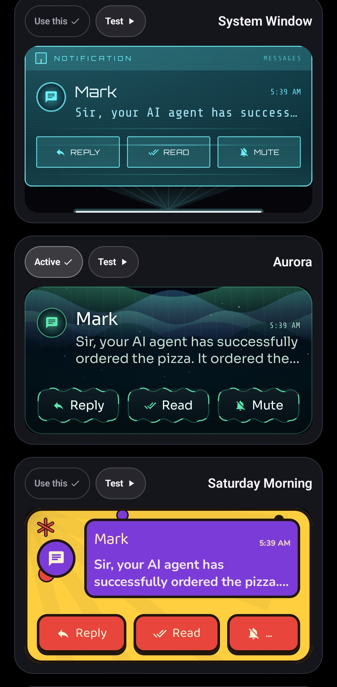
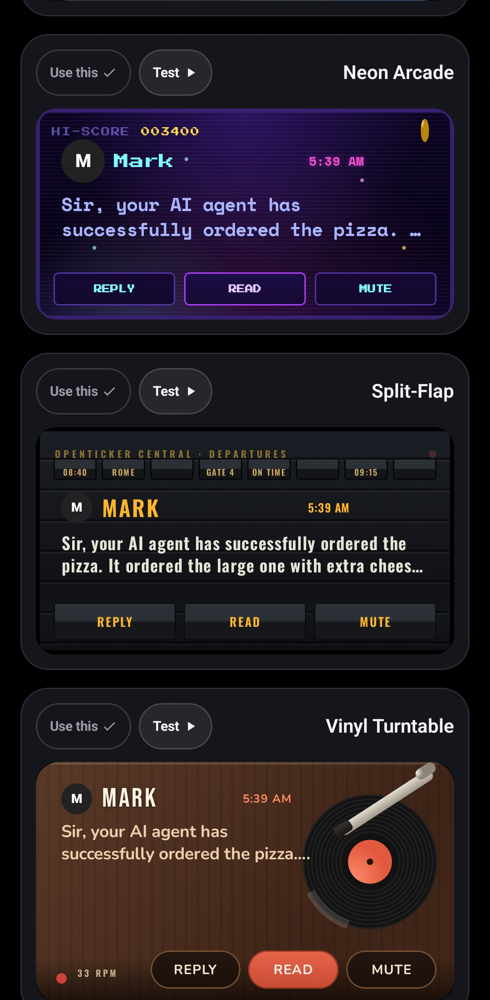

# OpenTicker

<div align="center">

<p align="center">
  
</p>

**Your notifications, reimagined.**

*No ads. No trackers. Nothing ever leaves your phone.*


</div>

---

## What it is

OpenTicker turns the notifications your phone already receives into little animated
characters that float over your other apps — a bento box served to you, a thunderstorm
rolling in, a zen garden, a neon arcade cabinet, a glass letter, a vinyl record, a map,
a terrarium, a frosted window and more.

Pick the style you like, say how long it should stay and how fast it should move, and
choose exactly which apps are allowed to appear. Everything runs on your device.

## Features

- **26 illustrated styles** — every one hand-built: Bento Box, Thunderstorm, Zen Garden,
  Neon Arcade, Carnival Marquee, Glass Letter, Vinyl Record, Origami, Terrarium, Frost,
  Polaroid, Terminal, Blueprint, Lava, Sticky Note, Flat Map, Radio Dial, Your Image and more.
- **Live previews** — the styles list renders the real card, animated, so you can see the
  scene before you choose it.
- **Reply without opening the app** — answer a message straight from the floating ticker.
- **Mark as read and mute** — act on a notification the way you would in the shade.
- **Your own image** — put any picture behind the notification and move, scale and fade it.
- **Motion controls** — scroll speed, animation speed, on-screen time and ticker width, each
  adjustable from 0.5× to 3×.
- **Per-app permission** — only the apps you allow can reach the ticker. System apps and
  OpenTicker itself are always hidden.
- **Always up to date** — a new notification replaces the current one, so the screen stays calm.
- **No ads, no trackers, no uploads** — notifications are read locally through Android's
  notification listener and never leave the device.

## Screenshots

<div align="center">
  
  
</div>

## Building

OpenTicker is a plain Android app with no special tooling. You need the Android SDK and
JDK 17 or newer.

```bash
git clone https://github.com/SlaveOfGod1/Openticker.git
cd Openticker

# point the build at your SDK (or set sdk.dir in local.properties)
echo "sdk.dir=/path/to/Android/sdk" > local.properties

./gradlew :app:assembleRelease
```

The signed release APK lands in `app/build/outputs/apk/release/app-release.apk`.
For a debug build, run `./gradlew :app:assembleDebug` and install it with
`./gradlew :app:installDebug`.

**Requirements**

| | |
|---|---|
| Android | 8.0 (API 26) and up |
| JDK | 17 or newer |
| Gradle | 8.14 (wrapper included) |
| Compile SDK | 34 |

OpenTicker needs two permissions to work: **notification access** (to read the
notifications it turns into tickers) and **display over other apps** (to float above
them). Both are requested from the Settings screen on first run.

## Donate

OpenTicker is free and always will be. If it made your day a little better, you can
buy me a coffee:

**Bitcoin:** `bc1qj8nt5trrwjsv2qz5amm3r7prmeed0d62tnk9xp`

## License

Released under the MIT License. See [LICENSE](LICENSE) for the full text.
